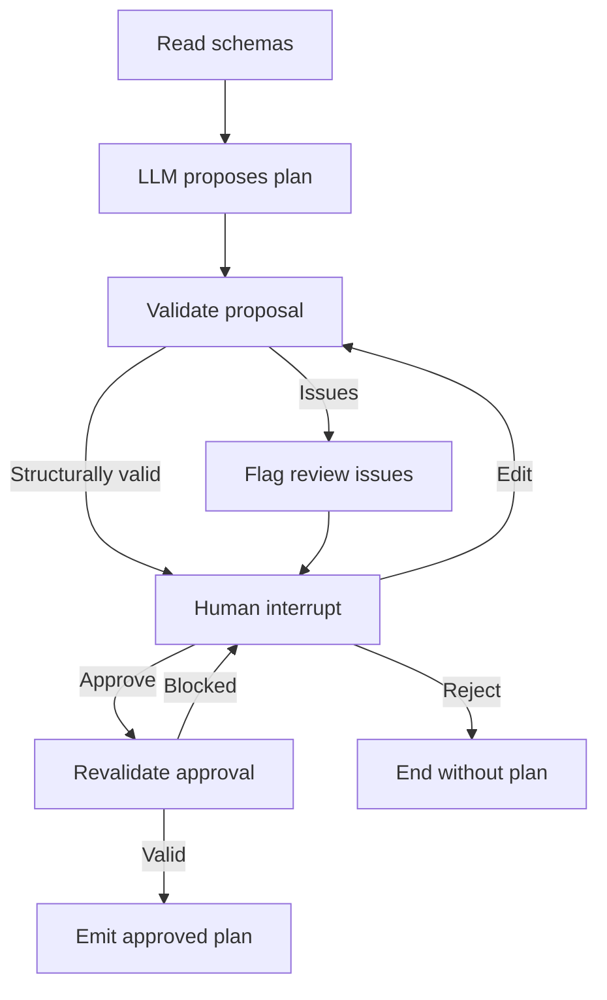

# SQLite migration-planning agent

A Python LangGraph agent that reads unfamiliar SQLite schemas, asks an LLM to propose semantic mappings, validates the proposal, pauses for human review, and emits an approved `MigrationPlan`. **No website, data transfer, destination writer, or post-migration verifier is included.**

## Install

Python **3.11+** (tested on 3.12). Extract the ZIP, then run from `migration-planner`:

```bash
python -m venv .venv
```

Windows PowerShell:

```powershell
.venv\Scripts\Activate.ps1
python -m pip install -r requirements.txt
$env:MIGRATION_API_URL="https://api.openai.com/v1"
$env:MIGRATION_API_KEY="your-api-key"
$env:MIGRATION_MODEL="gpt-4.1-mini"
```

macOS/Linux:

```bash
source .venv/bin/activate
python -m pip install -r requirements.txt
export MIGRATION_API_URL="https://api.openai.com/v1"
export MIGRATION_API_KEY="your-api-key"
export MIGRATION_MODEL="gpt-4.1-mini"
```

`OPENAI_API_KEY` is accepted if `MIGRATION_API_KEY` is absent. Compatible providers must support chat completions with JSON-object output. Set their base URL and model name. API setup lives only in `planner/adapter.py`; implement the `MappingAdapter` protocol to add a different provider. The graph never imports provider-specific APIs.

**Without a key the normal CLI stops. It does not substitute hardcoded mappings.** API failure or malformed model output also stops planning. Start a new run directory after correcting a failed initial model call. Review/resume of an existing pause does not require a key or another LLM call.

## Run the two synthetic examples

Four databases and two data dictionaries are already included in `examples/databases/`. The dictionaries explicitly document units, status translations, and business meaning; they are optional inputs supplied to the model, not mapping rules in Python. The production mapper contains no restaurant table or column names.

Pair A changes table/field names and translates status values. Pair B has a different naming scheme and conversions from grams to kilograms and cents to dollars.

```bash
python -m planner run --source examples/databases/pair_a_old.sqlite --destination examples/databases/pair_a_new.sqlite --context-file examples/databases/pair_a_context.txt --run-dir runs/pair-a
python -m planner run --source examples/databases/pair_b_old.sqlite --destination examples/databases/pair_b_new.sqlite --context-file examples/databases/pair_b_context.txt --run-dir runs/pair-b
```

For unfamiliar databases, supply their paths with the same command. Omit `--context-file` when no dictionary is available. Ambiguous business meaning, units or codes should remain unresolved until a human supplies evidence. Do not put customer records, secrets or personal data in the context file.

The CLI logs node decisions and prints status. Each new `--run-dir` must be empty. A run pauses with either `awaiting_approval` or `needs_review`. Inspect:

- `proposal.json`: structured proposed mappings, transformations and ID relationships.
- `status.json`: validation errors, uncertainty and review status.
- `events.jsonl`: timestamped decisions and validation results for the website team.
- `run.json`: stable run ID and local input paths.
- `checkpoint.sqlite`: LangGraph's persistent checkpoint, separate from both input databases.

```bash
python -m planner status --run-dir runs/pair-a
```

## Review and resume the same run

Every plan requires a human approval, even when structural checks pass. Confidence is not proof of semantic equivalence. Approval cannot bypass structural errors, unresolved fields, `needs_review` mappings, or confidence below 0.8. Low confidence is an additional review signal, never proof that a high-confidence mapping is correct.

### Approve

Create `approve.json` (use your name and actual review rationale):

```json
{
  "action": "approve",
  "reviewer": "Bala",
  "reason": "I checked field meanings, units, status translations, ID preservation and the business data dictionary."
}
```

```bash
python -m planner resume --run-dir runs/pair-a --decision approve.json
```

If issues remain, the graph pauses again with `blocked`; it does not emit a final plan. On successful approval it creates `runs/pair-a/final_plan.json`. Resume uses the same checkpoint and thread ID without asking the model to regenerate anything.

### Edit

Create an editable review file from the current proposal:

```bash
python examples/prepare_edit.py --run-dir runs/pair-a --output edit.json
```

Open `edit.json`. Update `reviewer` and `reason`, and edit the nested `plan`. Correct mappings and transformation parameters, document the new evidence in explanations, resolve `needs_review` entries, and remove genuinely resolved items from `unresolved_fields`. Confidence should reflect the available evidence; do not inflate it to bypass review. Every referenced field must still exist. You cannot approve silent source-table/field loss or unsupported operations.

```bash
python -m planner resume --run-dir runs/pair-a --decision edit.json
```

An edit is **not approval**. The graph validates the edited plan and pauses again. If it passes, resume with `approve.json` as above. If either schema changed after the initial inspection, start a new planning run against the current schemas instead of approving a stale plan.

### Reject

Create `reject.json`:

```json
{"action":"reject","reviewer":"Bala","reason":"The proposed mapping does not preserve the intended business meaning."}
```

```bash
python -m planner resume --run-dir runs/pair-a --decision reject.json
```

Rejection ends the run without a final plan. Completed/rejected runs cannot be resumed. Use a new directory for a new attempt. Reviewer names are audit labels supplied by the caller, not authentication; a future website must authenticate reviewers itself.

## Actual graph

Shared `PlannerState` carries schemas, proposal, validation errors, uncertainties, review state, final plan and event records. Nodes are separate Python functions compiled into an actual `StateGraph`:



Interrupt/resume uses `langgraph.types.interrupt`, `Command(resume=...)`, and `SqliteSaver`. Valid review payloads are Pydantic-validated. Invalid review data pauses again. `events.jsonl` is refreshed after each invocation; standard Python logging reports progress while it executes. A website can also consume LangGraph events directly from `build_graph`.

## Privacy and read-only guarantees

`inspect_database()` opens existing files using `mode=ro`, enables `query_only`, and installs a read-only SQLite authorizer. It collects table/column types, primary and unique keys, foreign keys (including composite keys), nullability, generated-field flags, default presence and a definition hash. It never selects application rows. It generates two synthetic type-example rows per table. These are explicitly labeled placeholders, not observed data or evidence of field meaning.

No whole databases, real row values, default expressions, or database paths are sent to the model. Schema/table/column names and your optional context are sent to the configured provider, so use only databases whose schema metadata you are authorized to share. Actual sample values are intentionally excluded even for synthetic fixtures, preventing an unsafe sampling mode from accidentally exposing production records.

Only the separate run directory is written. Artifact collision checks cover input paths and hard links. Tests verify unchanged database hashes. Demo creation is a separate utility that writes only newly created synthetic fixture databases, refusing existing files:

```bash
python examples/create_databases.py --output examples/fresh-databases
```

## Validation and supported scope

Python checks table/column existence, destination uniqueness, required-field coverage, source table/field coverage, generated columns, nullability/type changes, transformation parameters, evidence reference existence and FK endpoint compatibility. Every declared source/destination FK must be represented. Destination primary/unique keys must derive from declared source keys, preserving values. Missing evidence or unresolved meanings block approval.

Transformations are declarative: `identity`, `rename`, `unit_scale`, `enum_translate`, `cast`, `constant`. They are never evaluated by this project. For `unit_scale`, factor is a decimal string and means **destination value = source value × factor**. The future transfer engine must define overflow, rounding, precision and invalid-value policies before executing. For `enum_translate`, keys/values are strings; an unmapped real value must block transfer rather than be discarded. `constant` can represent an explicitly reviewed default, but cannot silently consume a source field.

V1 deliberately supports one source table per destination table and preserved IDs. Splits, merges, joins, regenerated ID lookups, views and virtual tables require human review and an extended transfer contract; merely approving cannot make them supported. Cyclic FKs can be represented but are not scheduled or executed. CHECK constraints, triggers, actual NULLs, value ranges, existing target conflicts and record correctness are not evaluated. All plans disclose these limitations. Schema validation and human approval are not post-migration verification.

## Exact transfer-engine interface

The transfer teammate should obtain a **completed** plan through:

```python
from planner.service import PlannerSession
from planner.models import MigrationPlan

plan: MigrationPlan = PlannerSession("runs/pair-a").final_plan()
payload: dict = plan.model_dump(mode="json")
```

`final_plan()` raises `ValueError` while paused, blocked or rejected. It reads the authoritative checkpoint rather than trusting an edited JSON export. The contract contains:

- `format_version`, `run_id`, `status="approved"`, `mapping_origin`.
- Source/destination schema SHA-256 fingerprints.
- `table_mappings` with field references, structured transformations, explanations, confidence, status and evidence IDs.
- `relationships` with source/destination FK endpoints and `preserve_ids` strategy.
- `unresolved_fields` (empty on approved plans), assumptions and limitations.
- Human approval name, rationale and timestamp.

`final_plan.json` is the same payload for cross-language consumers. `MigrationPlan.model_validate_json(...)` validates its **shape only**, not its authenticity or approval history. Use the checkpoint-backed accessor in this local integration; authenticate export delivery in a future service. The future transfer engine must reject `mapping_origin="test_fixture"`, match fingerprints using `planner.schema.inspect_database` and `digest`, perform its own data preflight, and decide whether its transformation implementation supports the plan. No transfer function is implemented or called here.

See `examples/sample_migration_plan.json` and `examples/migration_plan.schema.json` for the exact payload and JSON Schema. The sample is explicitly labeled `test_fixture` and was produced by the tested graph with a hand-authored fixture adapter; it is **not** represented as live AI output.

## Tests and observed verification

```bash
python -m unittest discover -s tests -v
```

Tests require no API key. Hand-authored response fixtures live only under `tests/`; the production CLI cannot select them. The first working end-to-end graph flow was executed before refinements using `python tests/smoke_flow.py`. It inspected schemas, paused, resumed in a new session, and emitted an approved **test fixture** plan.

Coverage includes both schema pairs, valid mapping/approval, ambiguity blocking approval, nonexistent-column repair, edits requiring separate approval, rejection, required fields, unknown record types, FK mismatches, duplicate destinations, real-row privacy, SQLite PK nullability, schema drift, read-only hashes, safe checkpoint locations and adapter payload/configuration.

**No API key was available during implementation. Live LLM semantic mapping against either pair remains unverified.** The actual API adapter is implemented and its protocol is mocked in tests; there is no deterministic runtime mapping fallback. The checkpoint/review/validation flow executes for real in those tests.

Official implementation references:
- https://docs.langchain.com/oss/python/langgraph/interrupts
- https://reference.langchain.com/python/langgraph/graph/state/StateGraph/compile
- https://developers.openai.com/api/docs/guides/function-calling (API provider context; this planner requests structured JSON rather than tool calls).
